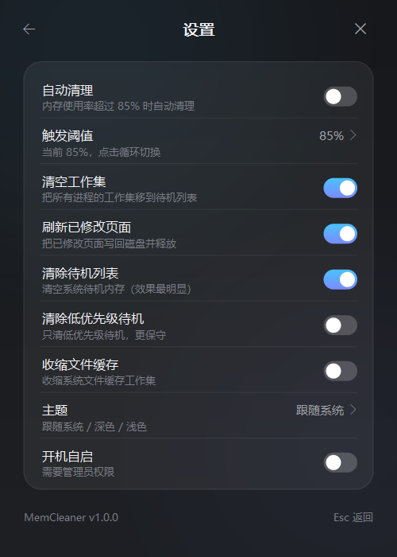
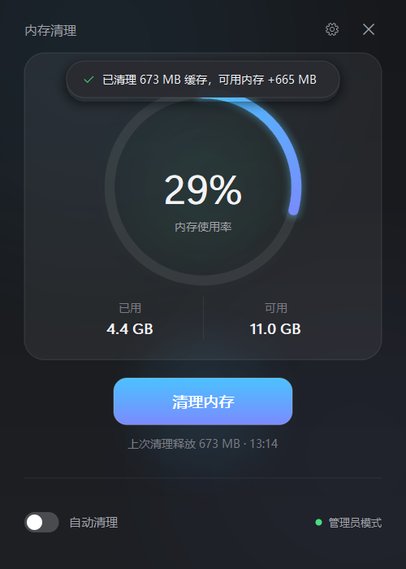

# MemCleaner

**极简、超低占用的 Windows 内存清理工具** —— 用 Rust 从零重写的「PCL 启动器内存优化」独立版。

界面为 Windows 11 / macOS 风格的无边框自绘窗口；清理能力与 PCL 2.13.1.1 的「内存优化」一致
（同一组 Windows 内核指令、同样的顺序与权限要求），常驻内存约 **3.5 MB**，Release 单文件约 **400 KB**。

[](LICENSE)
[](#系统要求)
[](https://www.rust-lang.org/)


---

## 特性

- **清理 = PCL 的「内存优化」**：启用 `SeProfileSingleProcessPrivilege` 后依次执行
  `NtSetSystemInformation(SystemMemoryListInformation = 80, &cmd, 4)`：
  `2` 清空所有进程工作集 → `3` 刷新已修改页面 → `4` 清除待机列表；
- **极低占用**：纯 Win32 + 软件光栅化（32bpp DIB）+ GDI 文字，不依赖 WebView / Direct2D /
  GDI+ / GUI 框架；空闲时 CPU ≈ 0，常驻 **Private ≈ 3.5 MB**；
- **管理员自动化**：首次确认 UAC 后，可一键注册「最高权限计划任务」实现开机静默启动到托盘，
  自动清理不再每次弹 UAC；
- **自动清理**：按内存占用阈值（默认 85%）或固定间隔触发，带冷却时间；
- **Win11/Mac 极简风 UI**：无边框窗口、DWM 圆角+阴影、抗锯齿圆环进度、按需 60fps 缓动动画、
  深色/浅色跟随系统、应用内确认框、托盘菜单、单实例；
- **可选项**：除 PCL 同款三项外，还支持「低优先级待机列表」「系统文件缓存收缩」（进阶，默认关闭）；
- **零联网、零遥测**：见[隐私政策](PRIVACY.md)；内存清理副作用说明见[安全政策](SECURITY.md)。

## 实测数据

测试环境：Windows 11 Pro build 26300，16 GB 内存，125% DPI。

| 项目 | 结果 |
|---|---|
| 常驻内存（Private / 任务管理器口径） | **3.46 – 3.48 MB**；WorkingSet ≈ 13.7 MB；100 次交互后无泄漏（ΔPrivate≈0、GDI 0） |
| 管理员模式进程占用（清理后） | Private **3.5 MB** / WorkingSet 4.1 MB / Handles 172 |
| 与 PCL `--memory` 同场对比 | PCL 381.4 MB / 349.4 MB；**MemCleaner 冷启动一次回收 929.1 MB**（同一组指令，差异来自运行时刻可回收量） |
| GUI 端到端清理 | 三条指令全部 `STATUS_SUCCESS`，程序自报回收 **673.4 MB**，可用内存 +443.2 MB |
| 自动化测试 | **111/111 断言通过**（UI 32 + 内存 10 + 行为 33 + CLI 27 + 单实例专项 9）+ `cargo test` 20/20 |

管理员权限验证详情：[docs/VERIFICATION.md](docs/VERIFICATION.md)；QA 报告：[docs/QA.md](docs/QA.md)。

## 截图

| 浅色主题 | 设置页 |
|---|---|
|  |  |

| 应用内确认框 | 管理员模式清理完成 |
|---|---|
|  |  |

## 下载与使用

1. 从 [Releases](https://github.com/Alerthater/MemCleaner/releases) 下载 `MemCleaner.exe`；
2. 双击运行 → 点「清理内存」；
   - 普通权限下会先弹应用内确认框，确认后触发一次 UAC，以管理员身份重启并立即清理；
3. 建议打开设置页开启「开机自启」：创建最高权限计划任务，之后登录即静默驻留托盘，自动清理无需 UAC；
4. 关闭窗口默认最小化到托盘；托盘图标右键可打开/立即清理/退出。

详细说明见 [docs/USER_GUIDE.md](docs/USER_GUIDE.md)。

> ⚠️ 内存清理会短暂清空文件缓存/工作集，随后系统需要重新读盘，属正常现象（PCL 的内存优化、
> Mem Reduct 等工具同理）。建议不要在大型游戏、编译、拷贝文件时清理。

## 系统要求

- Windows 10 1809+ / Windows 11，x64；
- 系统级清理需要管理员权限（UAC）；
- 圆角与系统阴影为 Windows 11 特性，Windows 10 上会退化为直角无阴影，功能不受影响。

## 构建

需要 Rust stable（MSVC 工具链）+ Visual Studio Build Tools（C++ 生成工具）+ Windows SDK：

```powershell
git clone https://github.com/Alerthater/MemCleaner.git
cd MemCleaner
cargo build --release
# 产物：target\release\MemCleaner.exe
```

运行测试：

```powershell
cargo test
```

## 命令行

```text
MemCleaner.exe                          启动主界面
MemCleaner.exe --autostart              静默启动到托盘（计划任务使用）
MemCleaner.exe --self-test --out x.json 命令行自检：输出清理前后/各指令 NTSTATUS（管理员下会真正清理）
MemCleaner.exe --install-autostart      安装开机自启计划任务（需管理员）
MemCleaner.exe --uninstall-autostart    卸载（需管理员）
MemCleaner.exe --version / --help
```

## 工作原理（简要）

Windows 没有「一条命令清所有内存」的公开 API；PCL 的「内存优化」实际是下面三步内核调用：

```
启用 SeProfileSingleProcessPrivilege
NtSetSystemInformation(80, { MemoryEmptyWorkingSets  = 2 }, 4)
NtSetSystemInformation(80, { MemoryFlushModifiedList = 3 }, 4)
NtSetSystemInformation(80, { MemoryPurgeStandbyList  = 4 }, 4)
```

MemCleaner 以管理员权限执行同样的序列，并用 `GlobalMemoryStatusEx` 与
`NtQuerySystemInformation(80)` 统计清理效果。完整技术说明（互操作性研究记录、枚举依据、
实测数据、复现方法）见 [docs/REVERSE_ENGINEERING.md](docs/REVERSE_ENGINEERING.md)。

> 关于「参考 PCL 的行为」而不是复制其代码的说明、以及全部第三方致谢，请阅读
> [NOTICE.md](NOTICE.md)。

## 目录结构

```
src/
  main.rs            入口：命令行、DPI、单实例、消息循环
  app.rs             窗口消息、状态机、定时器、清理工作线程、托盘
  engine.rs          清理引擎：测量 → 特权 → 2/3/4 → 再测量；自动清理判定
  selftest.rs        --self-test 自检模式（JSON 输出）
  config.rs          配置读写（原子写入 + 范围校验）
  sys/               Windows 内存接口与特权
  platform/          窗口、托盘、自启计划任务、提权、单实例、主题、图标
  ui/                UI 状态、命中测试、软件光栅化渲染
probes/BaselineProbe 独立验证探针（C#，可复现三条内核指令的实测）
tools/               验证脚本
docs/                技术说明、验证/QA 报告、使用说明、截图
```

## 验证与测试

- [docs/REVERSE_ENGINEERING.md](docs/REVERSE_ENGINEERING.md)：互操作性研究记录与实现规格
- [docs/VERIFICATION.md](docs/VERIFICATION.md)：管理员权限下与 PCL 同场实测（独立探针 + 真实 PCL 对比）
- [docs/QA.md](docs/QA.md)：UI/内存/泄漏/单实例/配置健壮性/CLI 自动化 QA
- `probes/BaselineProbe`：独立 C# 探针，可单独复现三条内核指令并读取系统内存列表

## 许可、来源与政策

- **代码许可**：[MIT License](LICENSE)（Copyright © 2026 Alerthater）
- **来源声明与第三方致谢**：[NOTICE.md](NOTICE.md) —— 声明对 PCL（龙腾猫跃）、Mem Reduct
  （Henry++）、phnt、Microsoft 文档等参考内容的范围与边界
- **隐私政策**：[PRIVACY.md](PRIVACY.md)（不联网、不收集数据）
- **安全政策**：[SECURITY.md](SECURITY.md)（漏洞报告、安全设计、下载渠道）
- **版权与合规总览**：[LEGAL.md](LEGAL.md)
- **贡献指南**：[CONTRIBUTING.md](CONTRIBUTING.md)

## 致谢

- **龙腾猫跃（LTCat）** 与 [Plain Craft Launcher](https://github.com/Meloong-Git/PCL)：
  其「内存优化」功能为本项目的清理实现提供了行为参考；
- [Mem Reduct](https://github.com/henrypp/memreduct)（Henry++）：同类软件功能划分的参考；
- [phnt](https://github.com/winsiderss/phnt)：原生 API 常量核对；
- Microsoft Windows 官方文档与 Rust 社区（`windows-sys`、`serde` 等依赖作者）。

## 免责声明

本项目为个人学习与自用工具，按「现状」提供，不附带任何明示或暗示担保。内存清理属于
「回收可回收缓存」的操作，可能造成短时磁盘读性能下降；请在了解其影响后使用。
本项目与 PCL、Mem Reduct、Microsoft 均无隶属或背书关系，相关名称仅用于事实性说明与致谢。
