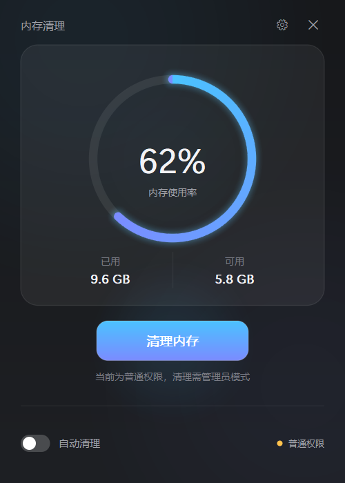
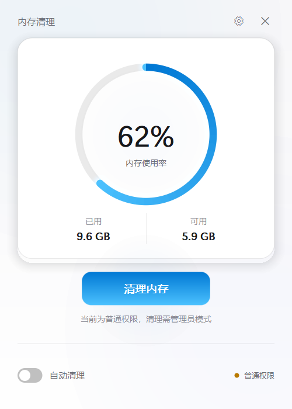
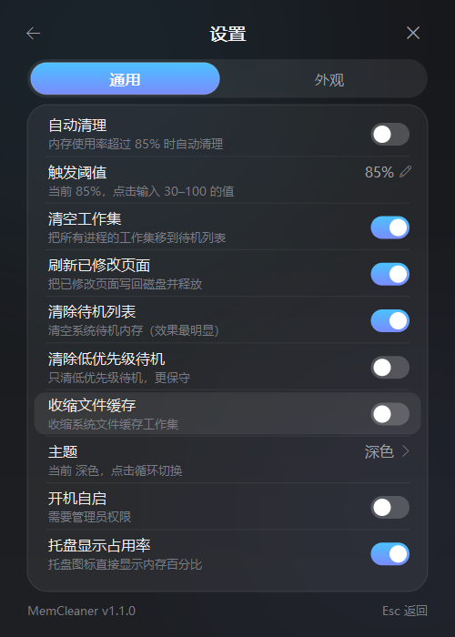
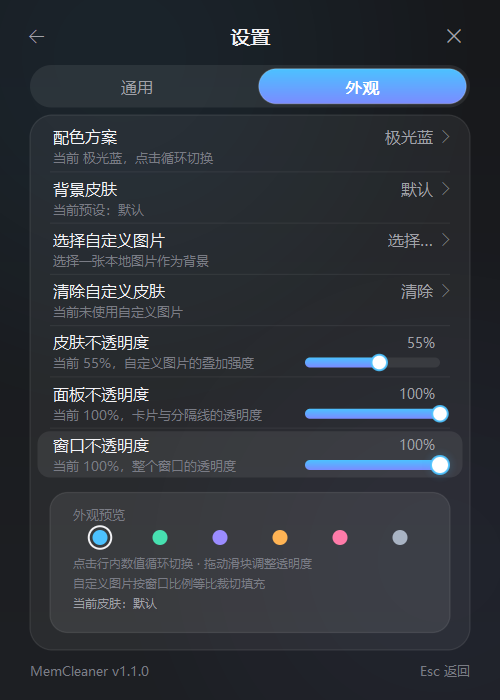
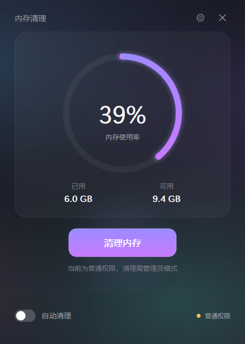
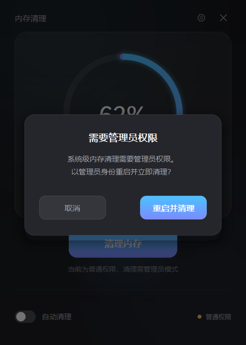

# MemCleaner

**极简、超低占用的 Windows 内存清理工具** —— 用 Rust 从零重写的「PCL 启动器内存优化」独立版。

界面为 Windows 11 / macOS 风格的无边框自绘窗口；清理能力与 PCL 2.13.1.1 的「内存优化」一致
（同一组 Windows 内核指令、同样的顺序与权限要求），常驻内存约 **3.7 MB**，Release 单文件约 **430 KB**。

[](LICENSE)
[](#系统要求)
[](https://www.rust-lang.org/)
[](https://github.com/Alerthater/MemCleaner/releases/latest)



---

## v1.3.0 修复（2026-10-28，最新）

- **清理更顺滑**：自动清理冷却时间提高到至少 180 秒（默认 300 秒），自动清理不再执行开销较大的
  「收缩文件缓存」；修正旧版 10 秒超时造成的「清理超时」误报，回收量过小时自动退避，避免频繁清理反而卡顿；
- **开机自启恢复为最高权限计划任务**：登录后以管理员权限静默驻留托盘，自动清理无需 UAC
  （v1.2.0 的 HKCU Run 只能普通权限启动，清理无法执行）；
- 详见 [CHANGELOG.md](CHANGELOG.md) 与 [验证报告](docs/VERIFICATION.md)。

## v1.2.0 修复（2026-10-26）

- **修复「自动清理一直失败」**：失败退避/连续失败暂停、权限能力检测、受限令牌守卫，
  不再每秒重试和刷屏；清理步骤/权限/托盘/自启状态写入诊断日志。
- **开机自启改为用户级 HKCU Run**：无需管理员/UAC，登录后以普通权限驻留托盘。
- **注意**：如果程序放在被系统标记为「Low 完整性」的目录（部分开发/沙箱工作区），
  Windows 会把进程降权，导致清理/托盘/配置失败——请把 exe 放到普通目录（如 `%LOCALAPPDATA%`）。
  详见 [CHANGELOG.md](CHANGELOG.md)。

## v1.1.1 修复（2026-10-25）

- **修复开机自启**：任务缺失/指向旧路径时自动重建；修正含空格路径的 `<Command>` 引号问题；
  登录时 Explorer 未就绪导致托盘注册失败会自动重试（Explorer 重启后也会恢复）；
  开启自启时取消 UAC 会回滚配置；新增 `--autostart-status` 诊断与本地诊断日志。
- 详细说明见 [CHANGELOG.md](CHANGELOG.md)。

## v1.1.0 新功能

- **托盘图标显示内存占用率**（可开关）：图标直接绘制百分比数字，并按内存压力变色（<75% 蓝 / 75–89% 琥珀 / ≥90% 红）；
- **自动清理阈值可直接输入**：30%–100% 自由调整，点击阈值行输入数字、Enter 确认，支持滚轮微调；
- **外观系统**：6 套配色（极光蓝 / 薄荷绿 / 紫罗兰 / 琥珀橙 / 樱粉 / 石墨灰）× 深/浅主题；
  4 套程序化皮肤（极光 / 星云 / 晨雾 / 暮色）+ **自定义本地图片皮肤**（PNG/JPG/BMP/GIF/WebP）；
  **皮肤 / 面板 / 窗口**三档透明度（窗口透明度为真实分层窗口 alpha，50–100%）；
- 设置页改为「通用 / 外观」分页，并带配色实时预览；
- **修复「收缩文件缓存」清理失败**：`SetSystemFileCacheSize` 需要 `SeIncreaseQuotaPrivilege`，
  v1.1.0 在调用前显式启用；管理员实测 `TrimFileCache` 返回成功（详见 [验证报告](docs/VERIFICATION.md)）。

## 特性

- **清理 = PCL 的「内存优化」**：启用 `SeProfileSingleProcessPrivilege` 后依次执行
  `NtSetSystemInformation(SystemMemoryListInformation = 80, &cmd, 4)`：
  `2` 清空所有进程工作集 → `3` 刷新已修改页面 → `4` 清除待机列表；
- **极低占用**：纯 Win32 + 软件光栅化（32bpp DIB）+ GDI 文字，不依赖 WebView / Direct2D /
  GDI+（仅自定义皮肤时按需加载系统 GDI+ 解码）/ GUI 框架；空闲时 CPU ≈ 0，常驻 **Private ≈ 3.7 MB**；
- **管理员自动化**：首次确认 UAC 后，可一键注册「最高权限计划任务」实现开机静默启动到托盘，
  自动清理不再每次弹 UAC；
- **自动清理**：按内存占用阈值（默认 85%，30–100 可调）触发，带冷却与失败退避（v1.3.0 起冷却 ≥180 秒，
  自动清理不收缩文件缓存，避免频繁清理造成卡顿）；
- **可选项**：除 PCL 同款三项外，还支持「低优先级待机列表」「系统文件缓存收缩」（进阶，默认关闭）；
- **零联网、零遥测**：见[隐私政策](PRIVACY.md)；内存清理副作用说明见[安全政策](SECURITY.md)。

## 截图

| 主界面（浅色） | 设置 · 通用 |
|---|---|
|  |  |

| 设置 · 外观（配色/皮肤/透明度） | 自定义图片皮肤 |
|---|---|
|  |  |

| 应用内确认框 | 管理员模式清理完成 |
|---|---|
|  |  |

## 实测数据（v1.3.0）

测试环境：Windows 11 Pro build 26300，16 GB 内存，125% DPI。

| 项目 | 结果 |
|---|---|
| 常驻内存（Private / 任务管理器口径） | **3.66 – 3.71 MB**（空闲/动画）；自定义图片皮肤开启时 +≈2.7 MB 解码缓存（可选功能） |
| 管理员模式进程占用（清理后） | Private **3.8 MB** / WorkingSet 4.3 MB / Handles 202 |
| 与 PCL `--memory` 同场对比 | PCL 480 MB / 600 MB；**MemCleaner 冷启动一次回收 511 MB**，GUI 端到端自报回收 **750 MB**（同一组指令，差异来自运行时刻可回收量） |
| 收缩文件缓存（v1.1.0 修复验证） | 管理员 `--self-test --with-file-cache`：`EmptyWorkingSets / FlushModifiedList / PurgeStandbyList / TrimFileCache` **全部成功** |
| 最高权限自启（v1.3.0 验证） | 计划任务启动进程 `integrity=High(0x3000)`、`elevated=true`；自动清理 `trim_cache=false`，4 步全部成功（约 10.8 s），无超时误报 |
| 干净清理效果（探针） | 三条内核指令全部 `STATUS_SUCCESS`；Standby **1063.5 MB → 31.6 MB** |
| 自动化测试 | `cargo test` **46 passed**；管理员验证含真实 PCL 对比、计划任务安装/卸载/幂等验证 |

管理员权限验证详情：[docs/VERIFICATION.md](docs/VERIFICATION.md)；QA 记录：[docs/QA.md](docs/QA.md)。

## 下载与使用

1. 从 [Releases](https://github.com/Alerthater/MemCleaner/releases) 下载 `MemCleaner.exe`；
2. 双击运行 → 点「清理内存」；
   - 普通权限下会先弹应用内确认框，确认后触发一次 UAC，以管理员身份重启并立即清理；
3. 建议打开设置页开启「开机自启」：创建最高权限计划任务，之后登录即静默驻留托盘，自动清理无需 UAC；
4. 设置页 →「外观」：选择配色/皮肤，或点「选择自定义图片」用本地图片做背景，并调节透明度；
5. 关闭窗口默认最小化到托盘；托盘图标右键可打开/立即清理/退出。

详细说明见 [docs/USER_GUIDE.md](docs/USER_GUIDE.md)。

> ⚠️ 内存清理会短暂清空文件缓存/工作集，随后系统需要重新读盘，属正常现象（PCL 的内存优化、
> Mem Reduct 等工具同理）。建议不要在大型游戏、编译、拷贝文件时清理。

## 系统要求

- Windows 10 1809+ / Windows 11，x64；
- 系统级清理需要管理员权限（UAC）；
- 圆角与系统阴影为 Windows 11 特性，Windows 10 上会退化为直角无阴影，功能不受影响；
- 自定义图片皮肤使用系统 GDI+（gdiplus.dll）解码，仅在选择图片时加载。

## 构建

需要 Rust stable（MSVC 工具链）+ Visual Studio Build Tools（C++ 生成工具）+ Windows SDK：

```powershell
git clone https://github.com/Alerthater/MemCleaner.git
cd MemCleaner
cargo build --release
# 产物：target\release\MemCleaner.exe
```

运行测试：

```powershell
cargo test
```

## 命令行

```text
MemCleaner.exe                          启动主界面
MemCleaner.exe --autostart              静默启动到托盘（计划任务使用）
MemCleaner.exe --self-test --out x.json 命令行自检：输出清理前后/各指令 NTSTATUS（管理员下会真正清理）
MemCleaner.exe --self-test --with-file-cache  自检附带「收缩文件缓存」项（验证用）
MemCleaner.exe --install-autostart      安装开机自启计划任务（需管理员）
MemCleaner.exe --uninstall-autostart    卸载（需管理员）
MemCleaner.exe --version / --help
```

## 工作原理（简要）

Windows 没有「一条命令清所有内存」的公开 API；PCL 的「内存优化」实际是下面三步内核调用：

```
启用 SeProfileSingleProcessPrivilege
NtSetSystemInformation(80, { MemoryEmptyWorkingSets  = 2 }, 4)
NtSetSystemInformation(80, { MemoryFlushModifiedList = 3 }, 4)
NtSetSystemInformation(80, { MemoryPurgeStandbyList  = 4 }, 4)
```

MemCleaner 以管理员权限执行同样的序列，并用 `GlobalMemoryStatusEx` 与
`NtQuerySystemInformation(80)` 统计清理效果；进阶的文件缓存收缩在启用
`SeIncreaseQuotaPrivilege` 后调用 `SetSystemFileCacheSize(-1, -1, 0)`。
完整技术说明见 [docs/REVERSE_ENGINEERING.md](docs/REVERSE_ENGINEERING.md)。

> 关于「参考 PCL 的行为」而不是复制其代码的说明、以及全部第三方致谢，请阅读
> [NOTICE.md](NOTICE.md)。

## 目录结构

```
src/
  main.rs            入口：命令行、DPI、单实例、消息循环
  app.rs             窗口消息、状态机、定时器、清理线程、托盘、外观/输入交互
  engine.rs          清理引擎：测量 → 特权 → 2/3/4 →（可选文件缓存）→ 再测量
  selftest.rs        --self-test 自检模式（JSON 输出）
  config.rs          配置读写（原子写入 + 范围校验 + BOM 兼容）
  sys/               Windows 内存接口与特权
  platform/          窗口、托盘（百分比图标）、自启任务、提权、单实例、主题、图标、
                     文件选择对话框、自定义皮肤解码（GDI+）
  ui/                UI 状态、命中测试、软件光栅化渲染、配色/皮肤/分页设置
probes/BaselineProbe 独立验证探针（C#）
tools/               验证脚本
docs/                技术说明、验证/QA 报告、使用说明、截图
```

## 验证与测试

- [docs/REVERSE_ENGINEERING.md](docs/REVERSE_ENGINEERING.md)：互操作性研究记录与实现规格
- [docs/VERIFICATION.md](docs/VERIFICATION.md)：管理员权限下与 PCL 同场实测（含文件缓存修复验证）
- [docs/QA.md](docs/QA.md)：UI/内存/泄漏/单实例/配置健壮性/CLI 自动化 QA
- `probes/BaselineProbe`：独立 C# 探针，可单独复现三条内核指令并读取系统内存列表

## 更新日志

见 [CHANGELOG.md](CHANGELOG.md)（v1.1.0 / v1.0.0）。

## 许可、来源与政策

- **代码许可**：[MIT License](LICENSE)（Copyright © 2026 Alerthater）
- **来源声明与第三方致谢**：[NOTICE.md](NOTICE.md) —— PCL（龙腾猫跃）、Mem Reduct（Henry++）、
  phnt、Microsoft 文档等参考内容的范围与边界
- **隐私政策**：[PRIVACY.md](PRIVACY.md)（不联网、不收集数据；自定义皮肤仅本地读取所选图片）
- **安全政策**：[SECURITY.md](SECURITY.md)
- **版权与合规总览**：[LEGAL.md](LEGAL.md)
- **贡献指南**：[CONTRIBUTING.md](CONTRIBUTING.md)

## 致谢

- **龙腾猫跃（LTCat）** 与 [Plain Craft Launcher](https://github.com/Meloong-Git/PCL)：
  其「内存优化」功能为本项目的清理实现提供了行为参考；
- [Mem Reduct](https://github.com/henrypp/memreduct)（Henry++）：同类软件功能划分的参考；
- [phnt](https://github.com/winsiderss/phnt)：原生 API 常量核对；
- Microsoft Windows 官方文档与 Rust 社区（`windows-sys`、`serde` 等依赖作者）。

## 免责声明

本项目为个人学习与自用工具，按「现状」提供，不附带任何明示或暗示担保。内存清理属于
「回收可回收缓存」的操作，可能造成短时磁盘读性能下降；请在了解其影响后使用。
本项目与 PCL、Mem Reduct、Microsoft 均无隶属或背书关系，相关名称仅用于事实性说明与致谢。
